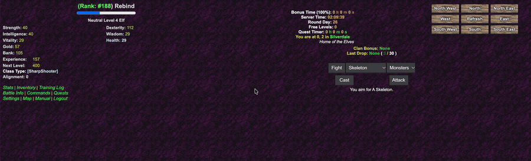
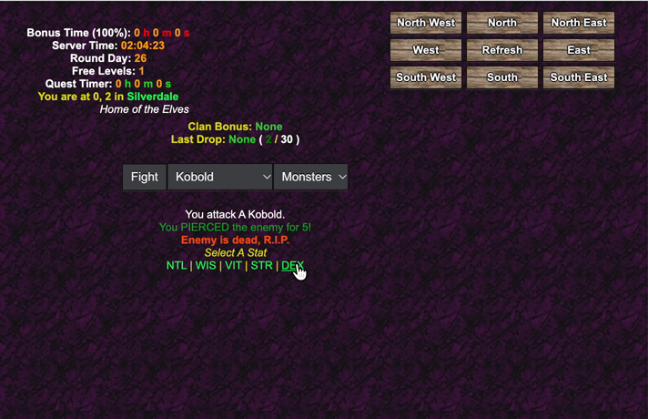
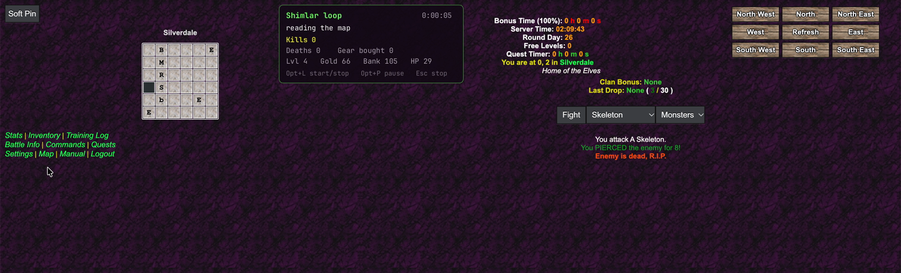
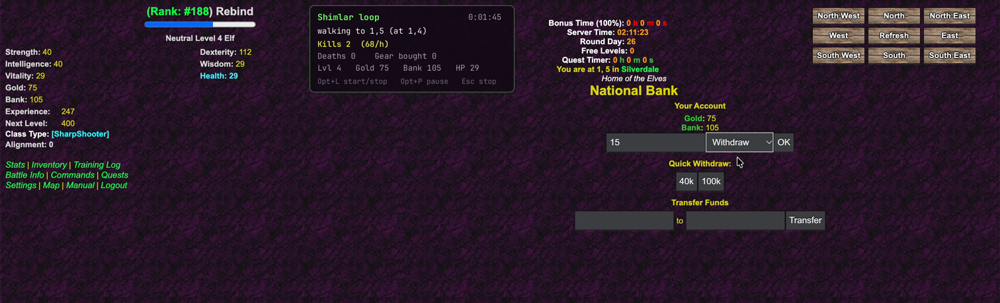
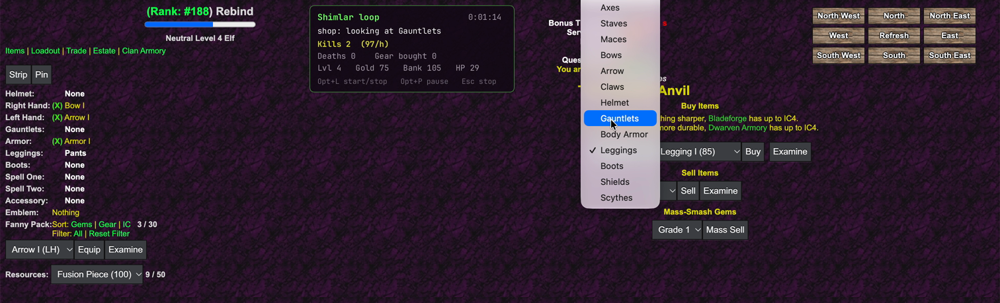
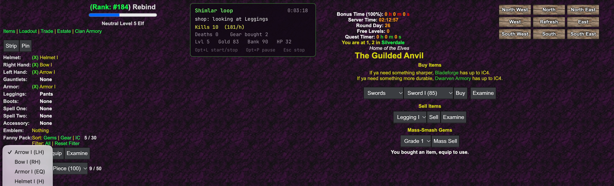
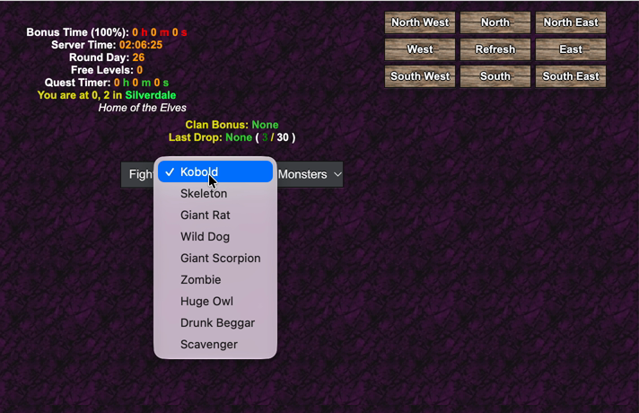
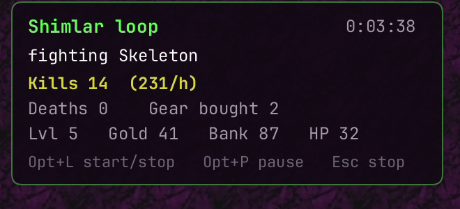
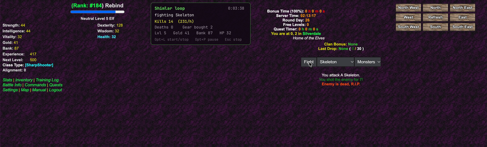

# Shimlar Macro

A [Rebind](https://rebind.gg) script for [Shimlar](https://shimlar.org).

**Press one key and your Shimlar character plays itself:** it fights, levels,
banks its gold, buys and wears better gear, and moves on to stronger monsters,
with a live HUD showing what it is doing.



*A level 1 character, four minutes of play at 8x speed. Nothing is scripted
for this screen: the loop reads the page and decides each click.*
[Watch the one-minute video](assets/demo.mp4).

## What it does for you

### Fights, and picks your stat on every level up

It clicks Fight, then Attack (or Cast, your choice) until the monster is dead,
and when you level it raises the stat you chose.



### Finds the bank, the shop and the infirmary by itself

On its first pause it opens the zone map, reads the tile grid, and works out
where you are and where everything is. No coordinates to type.



### Banks your gold before you can lose it

When the gold you carry reaches a share of everything you own (20% unless you
change it), it walks to the bank, deposits, and walks back to the same square.
It also banks before trying a stronger monster, so a death costs you nothing.



### Buys and equips better gear when you can afford it

It checks what you are wearing, remembers what the shop charges, and goes
shopping only when a real upgrade fits the budget. It withdraws the gold,
buys the best tier it can afford and wear for each slot, and puts it on.
Weapons stay in the family you already use.




### Climbs to stronger monsters, and backs off when they bite

After a run of easy kills it picks the next monster on the list. If fights get
long, or your health drops, it steps back down. If something kills you, it
walks to the infirmary, revives, returns, and leaves that monster alone for a
few levels.



### Shows you everything on a small HUD



What it is doing right now, kills and kills per hour, deaths, gear bought,
level, gold, bank, health and run time. Put it in any screen corner or inside
the game window, and switch on "show in recordings" if you stream or record.



## In our test run

A brand-new level 1 character, left alone for about eight minutes:

- walked off the starting square to a monster tile by reading the map
- reached level 5
- bought and equipped Armor I, Helmet I and Legging I as the gold came in
- moved from Kobold to Skeleton after 15 easy kills
- ran at about 230 kills an hour, walking and shopping included

## How this was made

This script was not written by hand. It was created in an agentic session:
an AI coding agent (Claude Code) working through [Rebind](https://rebind.gg).

It started from a **Rebind observation**: a two-minute recording of the game
being played by hand, holding every click with its position, the active
window, and screenshots. The agent read that recording, worked out the fight
loop from it, and wrote the first version. From there it drove the real game
through Rebind to explore the bank, the shop and the map, wrote each feature,
ran it live, read its own logs and screenshots, and fixed what broke. The
footage on this page is the finished script playing a new character.

## Controls

| Key | What it does |
|---|---|
| `Option+L` | Start or stop the loop |
| `Option+P` | Pause or resume |
| `Esc` | Stop |

The loop also **pauses by itself** whenever the Shimlar tab is not the front
window, and carries on when you come back. It never clicks into another app.

## Settings

All in Rebind's options for the script.

| Setting | Default |
|---|---|
| Stat to raise on level up | dex |
| In a fight | attack (or cast) |
| Bank gold | on, at 20% of all your gold and at least 100 |
| Buy and equip better gear | on, spending up to 50% of all your gold per trip |
| Revive at the infirmary after a death | on |
| Move on to stronger monsters | on, after 15 easy kills in a row |
| Bank, shop and infirmary squares | auto (from the map), or type `x,y` |
| Where the HUD sits | bottom-right; any corner, or in the game window |
| Show the HUD in screenshots and recordings | off |
| Extra wait after each click | 250 ms |

## How it works

Before every click the script takes a picture of the browser window and reads
the words on it with macOS text recognition. It finds the buttons, your gold,
your health and your position from what is actually on screen, so it works at
any window size and follows the page when banners or extra lines move things
around. The mouse glides to each target and clicks a slightly different spot
each time. It does not touch the game's code, the network, or the page itself.

## What you need

- macOS, with [Rebind](https://rebind.gg) 3.19 or later
- Xcode's command line tools (the script compiles its small screen reader the
  first time it runs; that takes a few seconds)
- Shimlar open at `shimlar.org/modern.php`, in the front window, with the page
  at 100% zoom
- The first screen read after a restart can take up to a minute; after that
  each one takes a fraction of a second

## Getting started

1. Get [Rebind](https://rebind.gg), then clone this repository and install it:

   ```sh
   git clone https://github.com/oeo/shimlar-macro
   cd shimlar-macro
   rebind pack .
   rebind install shimlar-macro.rbp --allow
   rebind script start packages/shimlar-macro/main.luau
   ```

2. Open Shimlar and log in.
3. Press `Option+L`.

It works from wherever you stand: if your square has no monsters, it reads the
map and walks to one that does.

## Good to know

- **Tested in Silverdale.** It assumes B, R and S on the map mean bank,
  infirmary and shop. In a zone that uses other letters, type the squares into
  the settings.
- **It learns a monster is too strong by fighting it.** Expect an occasional
  death while it climbs; your gold is banked first. Turn "Move on to stronger
  monsters" off to choose monsters yourself.
- **It keeps old gear.** Replaced items stay in your pack; it does not sell.
- **Not yet proven:** the cast option, stats other than DEX, tier II gear
  purchases, and windows narrower than about 1,300 pixels (the HUD then stays
  in its screen corner).
- **It holds the mouse while it runs.** Pause it before doing something else.
- **Play by the game's rules.** Check what Shimlar allows before you leave it
  running; you use this at your own risk.
